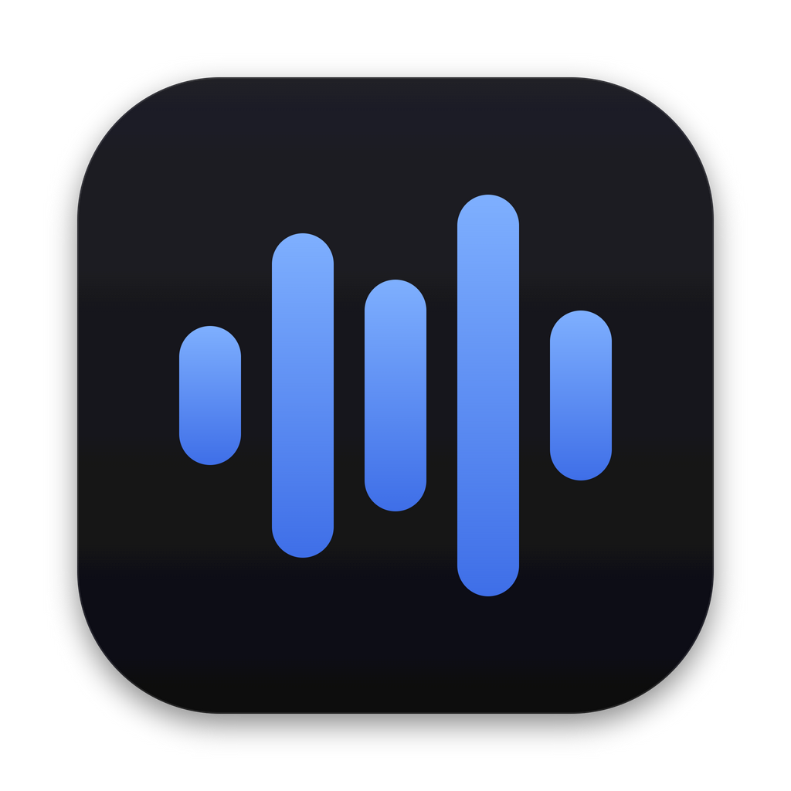
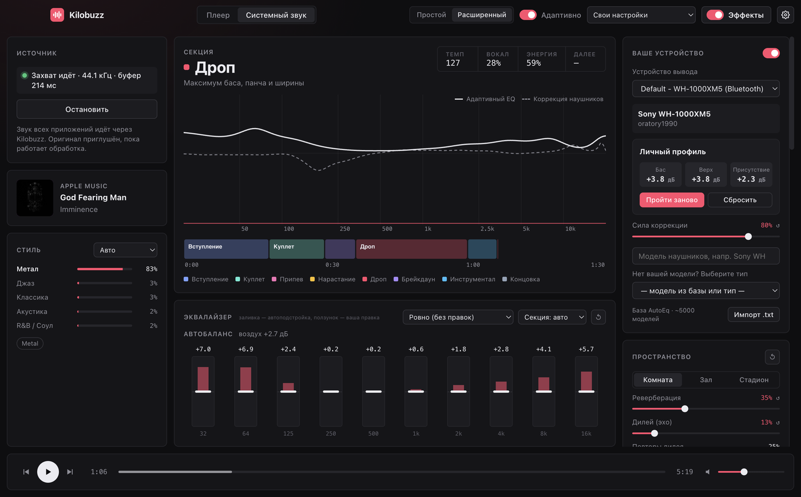
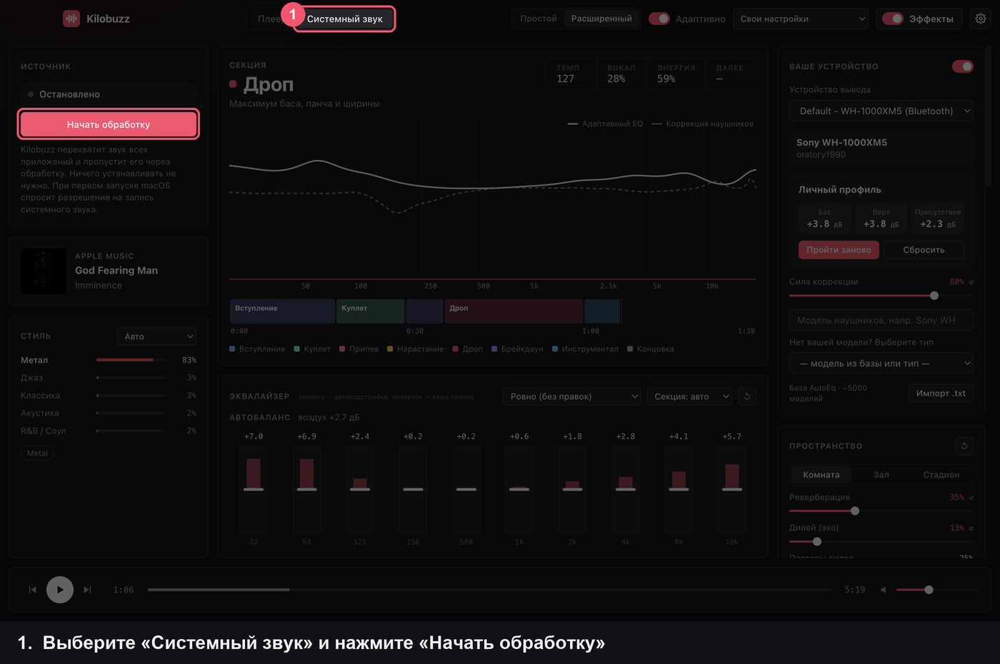
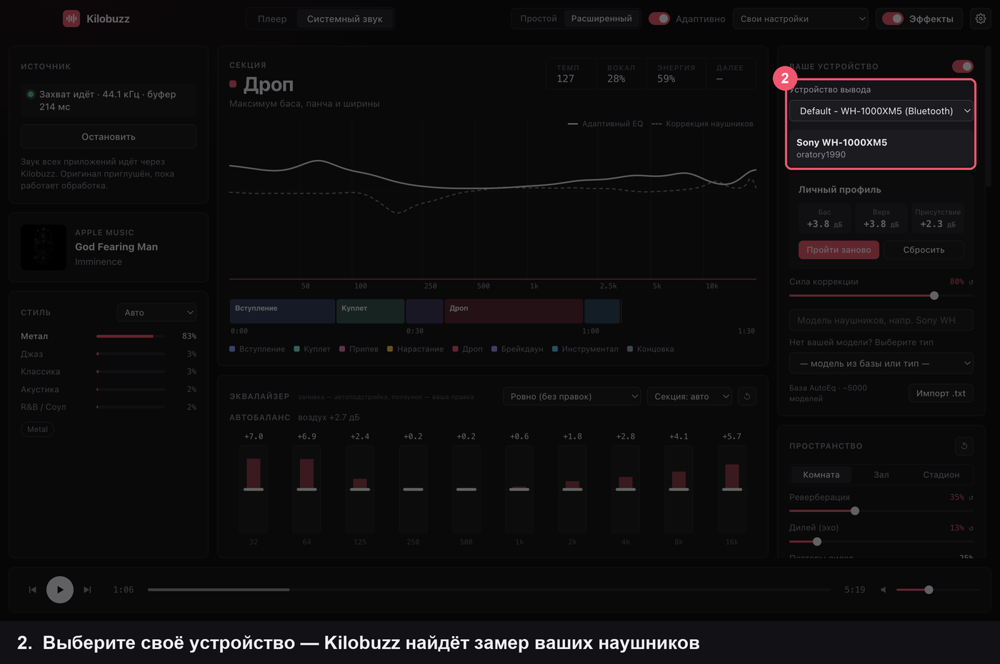
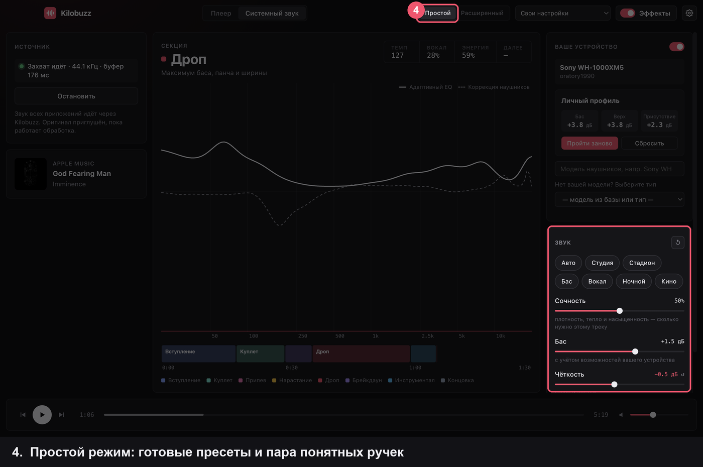
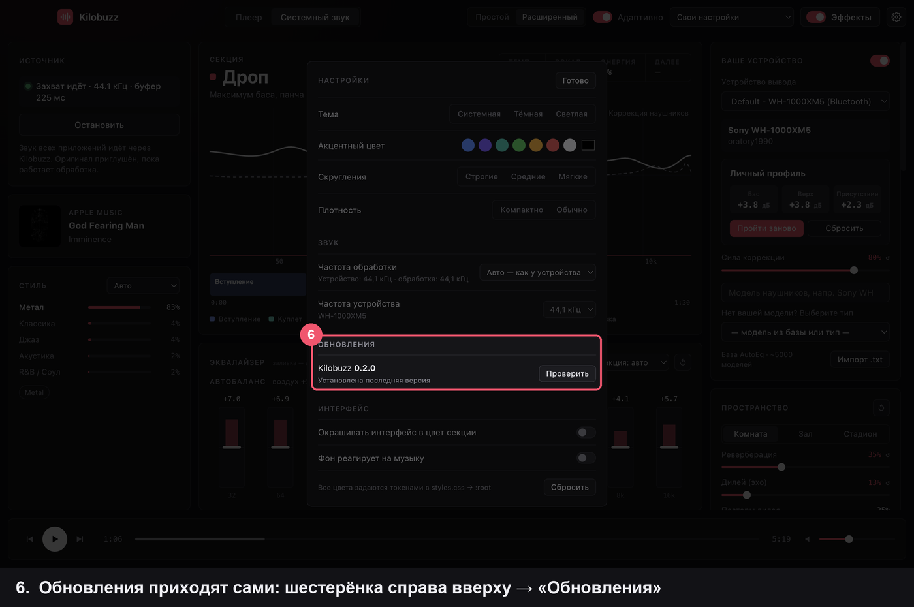

<p align="center">
  
</p>

<h1 align="center">Kilobuzz</h1>

<p align="center">
  Адаптивный эквалайзер для macOS и Windows.<br>
  Подстраивает звук под ваши наушники, стиль трека и каждую часть песни — прямо во время прослушивания.
</p>

<p align="center">
  <a href="https://github.com/madhuron/kilobuzz/releases/latest"></a>
  
  
  <a href="LICENSE"></a>
</p>

<p align="center">
  
</p>

---

## Скачать

| Система | Файл |
|---|---|
| **macOS** (Apple Silicon и Intel) | `Kilobuzz-<версия>-universal.dmg` |
| **Windows 10 / 11** (x64) | `Kilobuzz-Setup-<версия>.exe` |

Все версии — на странице **[Releases](https://github.com/madhuron/kilobuzz/releases/latest)**.
Дальше Kilobuzz следит за обновлениями сам: при каждом запуске проверяет новую версию и показывает уведомление
«Обновиться / Позже». После «Обновиться» новая версия скачивается и ставится, а Kilobuzz перезапускается.

<details>
<summary><b>Первый запуск: система предупреждает о неизвестном разработчике</b></summary>

Kilobuzz пока не подписан платными сертификатами Apple и Microsoft, поэтому при первом запуске:

- **macOS** — откройте `.dmg`, перетащите Kilobuzz в «Программы», затем в Finder нажмите на приложение
  правой кнопкой → «Открыть» → «Открыть». Если macOS пишет, что приложение «повреждено», выполните в Терминале:
  `xattr -dr com.apple.quarantine /Applications/Kilobuzz.app`
- **Windows** — в окне SmartScreen нажмите «Подробнее» → «Выполнить в любом случае».

Это нужно сделать один раз — обновления ставятся без предупреждений.
</details>

## С чего начать

### 1. Включите обработку
Вкладка «Системный звук» → «Начать обработку», и включайте музыку в любом плеере.
На Windows один раз нажмите «Установить модуль Kilobuzz» и подтвердите окно Windows.



### 2. Выберите свои наушники или колонки
Kilobuzz сам предложит модель по названию устройства. Проверьте, что она верная, или найдите свою через поиск.
Если модели нет в базе — выберите тип устройства.



### 3. Пройдите «Личный профиль»
Нажмите «Настроить»: минута на слух — выбирайте, какой из двух вариантов нравится больше.


### 4. Подкрутите по вкусу
В простом режиме — пресеты («Студия», «Бас», «Вокал»…) и ручки «Сочность», «Бас», «Чёткость».
В расширенном — эквалайзер, обработка, пространство и всё остальное.



### 5. Сравните с оригиналом
Переключатель «Эффекты» (или клавиша `B`). Громкость при этом не меняется, поэтому разница честная.


### 6. Обновления приходят сами
При каждом запуске Kilobuzz проверяет новую версию. Если она есть, справа внизу появится уведомление:
«Обновиться» — скачать и установить (Kilobuzz перезапустится), «Позже» — напомнить при следующем запуске.
Проверить вручную: настройки ⚙ → «Обновления».



## Что умеет

- **Ваши наушники и колонки.** Выберите модель — Kilobuzz загрузит её замер из базы
  [AutoEq](https://github.com/jaakkopasanen/AutoEq) (≈5000 моделей), покажет АЧХ и мягко её выровняет.
- **Стиль трека.** Жанр определяется по каталогу Apple Music, тегам MusicBrainz и самому звуку.
- **Части песни.** Вступление, куплет, припев, нарастание, дроп, брейкдаун — у каждой своя подача.
- **Чистка, а не окраска.** Де-эссер, подавление резонансов («Анти-бочка»), снятие маскировки между
  инструментами, разбор на лету на кик / бас / остальное, восстановление ударов на пересжатых мастерах.
- **Честная громкость.** Автогромкость сравнивает звук до и после обработки, поэтому лучше — не значит громче.
- **Личный профиль.** Короткий тест на слух (A/B, ~1 минута) подбирает баланс баса, верха и присутствия под вас.
- **Пространство.** Виртуальная сцена «5.1 / 7.1» для наушников, реверберация и дилей (по умолчанию едва заметные).
- **Плеер под рукой.** Обложка, исполнитель и управление Apple Music и Spotify; громкость связана с системной.
- **Простой и расширенный режим**, пресеты, сброс каждого блока, темы оформления.

## Как работает системный звук

- **macOS 14.2+** — ничего устанавливать не нужно: звук всех приложений перехватывается через Core Audio
  (process tap). macOS один раз спросит разрешение на запись системного звука.
- **Windows** — собственный модуль обработки (APO) внутри звуковой системы Windows, как у Equalizer APO.
  Ставится одной кнопкой с подтверждением администратора, без виртуальных кабелей и без подписи драйверов.
  Работает, только пока открыт Kilobuzz, и не заменяет эффекты звуковой карты (Realtek, Dolby, Sony…) —
  встраивается после них. Удаление Kilobuzz возвращает настройки устройств как было.
- **Плеер** — перетащите файлы в окно: трек анализируется целиком, и смена подачи попадает точно в дроп.

## Сборка из исходников

Нужны [Node.js](https://nodejs.org) 20+ и, для macOS, Xcode Command Line Tools (`xcode-select --install`).

```bash
npm install
npm start               # запуск без сборки
npm run dist:mac        # macOS: dist/Kilobuzz-<версия>-universal.dmg
npm run dist:win        # Windows: dist/Kilobuzz-Setup-<версия>.exe
```

Модуль Windows собирается компилятором mingw-w64 — на macOS (`brew install mingw-w64`) или в
[MSYS2](https://www.msys2.org) на Windows (`pacman -S mingw-w64-x86_64-gcc`): `npm run build:win-native`.

### Выпуск новой версии

1. Поднимите `version` в `package.json`.
2. `git commit -am "Kilobuzz 1.2.3" && git tag v1.2.3 && git push --follow-tags`
3. GitHub Actions соберёт установщики для macOS и Windows и опубликует их в Releases — установленные
   копии Kilobuzz получат обновление автоматически.

## Устройство проекта

```
src/main/            Electron: окно, захват звука, модуль Windows, обновления, данные плеера
src/renderer/        интерфейс и звуковой движок (Web Audio + AudioWorklet)
  js/audio/          анализ (признаки, темп, структура, стиль) и обработка
native/mac/          захват системного звука macOS (Core Audio process tap)
native/win/          модуль Windows (APO): обработка на C++, установщик, связь с приложением
build/               иконки, entitlements, скрипт установщика Windows
.github/workflows/   сборка и публикация релизов
```

| Файл | Что делает |
|---|---|
| `src/renderer/js/audio/engine.js` | звуковой граф: коррекция, EQ, обработка, пространство, лимитер |
| `src/renderer/js/audio/worklets.js` | DSP в AudioWorklet: разбор на дорожки, компрессор, де-эссер, лимитер… |
| `native/win/dsp.h`, `stems.h` | та же обработка на C++ для модуля Windows (совпадает с приложением до −80 дБ) |
| `src/renderer/js/audio/adaptive.js`, `profiles.js` | как стиль, часть песни и профиль слушателя влияют на звук |
| `src/main/updater.js` | обновления через GitHub Releases |

## Горячие клавиши

`Пробел` — пуск / пауза · `B` — обработка вкл/выкл (сравнить с оригиналом) · двойной клик по ползунку — сброс

## Лицензия

[MIT](LICENSE). Замеры наушников — проект [AutoEq](https://github.com/jaakkopasanen/AutoEq) (MIT).
